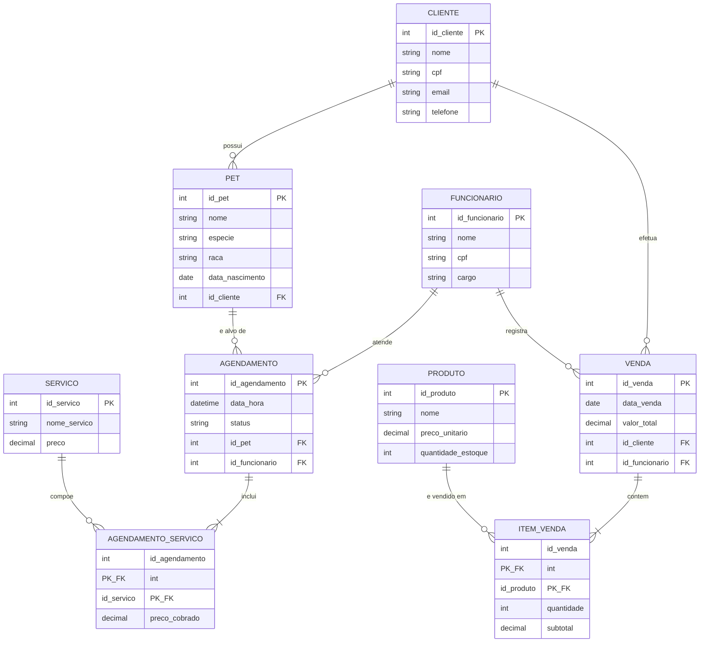

# Modelo de Entidade e Relacionamento (MER) — Sistema de Petshop

## 1. Entidades

| Entidade | Definição |
|---|---|
| **Cliente** | Pessoa que possui um ou mais pets, contrata serviços e/ou compra produtos no petshop. |
| **Pet** | Animal de estimação cadastrado no sistema, vinculado a um cliente responsável. |
| **Funcionário** | Colaborador do petshop (atendente, tosador, banhista ou veterinário) responsável por executar serviços e registrar vendas. |
| **Serviço** | Item do catálogo de atendimento oferecido pelo petshop (ex.: banho, tosa, consulta veterinária, vacinação). |
| **Agendamento** | Marcação de atendimento de um ou mais serviços para um pet específico, em uma data/hora, sob responsabilidade de um funcionário. |
| **Agendamento_Servico** | Entidade associativa que resolve o relacionamento N:N entre Agendamento e Serviço, permitindo que um agendamento contenha múltiplos serviços. |
| **Produto** | Item físico disponível para venda no petshop (ração, brinquedos, medicamentos, acessórios). |
| **Venda** | Registro de uma transação comercial de produtos realizada por um cliente e registrada por um funcionário. |
| **Item_Venda** | Entidade associativa que resolve o relacionamento N:N entre Venda e Produto, detalhando quantidade e valor de cada produto vendido. |

## 2. Relacionamentos e Cardinalidades

1. **[Cliente] (1,1) `possui` (0,N) [Pet]**
   Um cliente pode possuir zero ou vários pets cadastrados, mas cada pet pertence obrigatoriamente a exatamente um cliente.

2. **[Pet] (1,1) `é alvo de` (0,N) [Agendamento]**
   Um pet pode ter vários agendamentos ao longo do tempo (formando seu histórico), mas cada agendamento se refere a um único pet.

3. **[Funcionário] (1,1) `atende` (0,N) [Agendamento]**
   Um funcionário pode atender diversos agendamentos, porém cada agendamento tem apenas um funcionário responsável.

4. **[Agendamento] (1,1) `inclui` (1,N) [Agendamento_Servico]**
   Todo agendamento deve incluir pelo menos um serviço, podendo incluir vários (ex.: banho + tosa no mesmo horário).

5. **[Serviço] (1,1) `compõe` (0,N) [Agendamento_Servico]**
   Um serviço do catálogo pode estar presente em vários agendamentos diferentes, ou ainda não ter sido utilizado em nenhum.

6. **[Cliente] (1,1) `efetua` (0,N) [Venda]**
   Um cliente pode realizar várias compras ao longo do tempo, mas cada venda pertence a apenas um cliente.

7. **[Funcionário] (1,1) `registra` (0,N) [Venda]**
   Um funcionário pode registrar várias vendas, mas cada venda é registrada por um único funcionário.

8. **[Venda] (1,1) `contém` (1,N) [Item_Venda]**
   Toda venda deve conter ao menos um item (produto), podendo conter vários produtos diferentes.

9. **[Produto] (1,1) `é vendido em` (0,N) [Item_Venda]**
   Um produto pode aparecer em vários itens de venda diferentes, ou ainda nunca ter sido vendido.

## 3. Sugestão de Atributos

### Cliente
- **id_cliente** (PK)
- nome
- cpf
- email
- endereco *(atributo composto: logradouro, número, bairro, cidade, CEP)*
- telefone *(atributo multivalorado — cliente pode ter mais de um telefone de contato)*
- data_cadastro

### Pet
- **id_pet** (PK)
- nome
- especie
- raca
- data_nascimento
- idade *(atributo derivado, calculado a partir de data_nascimento)*
- peso
- id_cliente (FK)

### Funcionário
- **id_funcionario** (PK)
- nome
- cpf
- cargo
- data_admissao
- salario
- telefone

### Serviço
- **id_servico** (PK)
- nome_servico
- descricao
- preco
- duracao_estimada

### Agendamento
- **id_agendamento** (PK)
- data_hora
- status *(ex.: agendado, concluído, cancelado)*
- observacoes
- id_pet (FK)
- id_funcionario (FK)

### Agendamento_Servico (associativa)
- **id_agendamento** (PK, FK)
- **id_servico** (PK, FK)
- preco_cobrado *(pode diferir do preço padrão do serviço em caso de promoção)*

### Produto
- **id_produto** (PK)
- nome
- descricao
- categoria
- preco_unitario
- quantidade_estoque
- fornecedor

### Venda
- **id_venda** (PK)
- data_venda
- forma_pagamento
- valor_total *(atributo derivado, calculado a partir da soma dos subtotais de Item_Venda)*
- id_cliente (FK)
- id_funcionario (FK)

### Item_Venda (associativa)
- **id_venda** (PK, FK)
- **id_produto** (PK, FK)
- quantidade
- preco_unitario_venda
- subtotal *(atributo derivado = quantidade × preco_unitario_venda)*

## 4. Diagrama Entidade e Relacionamento (DER)

Diagrama construído com **Mermaid.js**, renderizado automaticamente pelo GitHub ao visualizar este arquivo:

